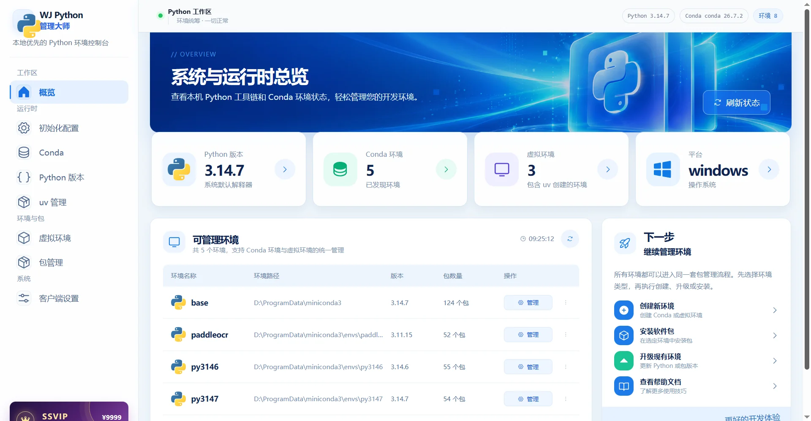
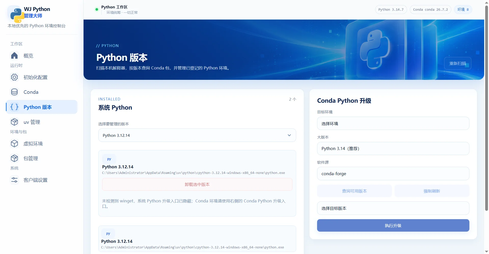
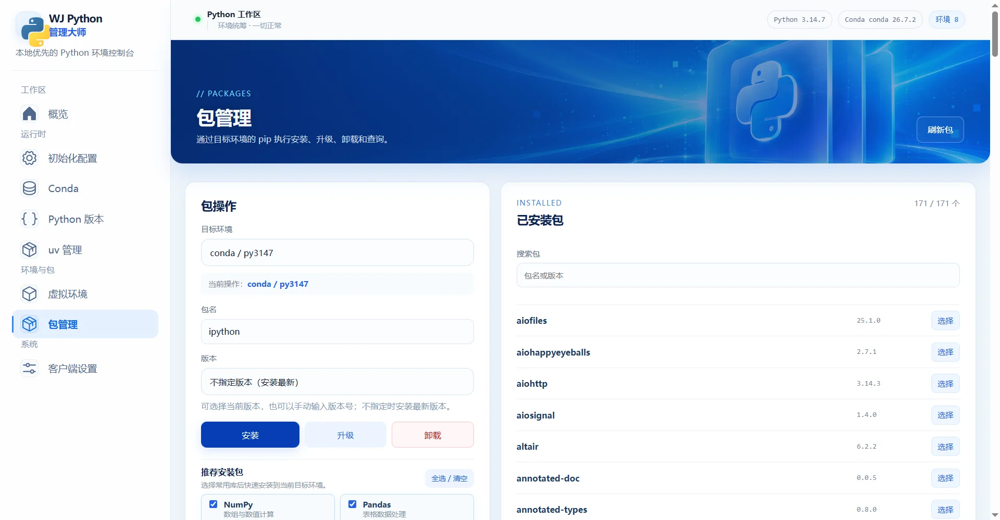

# WJ Python 管理大师

WJ Python 管理大师是一款面向 Windows 的本地 Python 环境管理工具。它把 Python、Conda、`venv`、`uv` 和 `pip` 的常用操作集中到一个桌面应用中，方便查看环境、管理依赖和维护本机 Python 工具链。

> **SSVIP 说明：** SSVIP 会员与付费提示仅供娱乐，是应用内的主题体验彩蛋，不代表真实商品、收费或服务，也不会触发支付。体验密钥：`greed is good`。

## 界面预览

### 环境概览



### Python 版本管理



### Python 包管理



### SSVIP 主题体验


## 功能

- **环境概览：** 查看 Python、Conda、虚拟环境和平台状态。
- **初始化配置：** 检查 Conda，按向导配置 Miniconda 和首个 Python 环境。
- **Conda 管理：** 创建、克隆、删除环境，导入或导出 YAML，并检查 Conda 更新。
- **Python 版本：** 扫描本机 Python、查询可用版本，并升级受支持的系统或 Conda Python。
- **虚拟环境：** 创建和扫描 `venv`、`uv` 环境，包括项目 `.venv`。
- **包管理：** 安装、升级、卸载和查询包，也可从 `requirements.txt` 批量安装。
- **uv 管理：** 检查、安装或卸载 uv，导入或导出环境依赖。
- **本地设置：** 自定义首页标语、背景和配色，查看任务日志与运行进程。

## 安装与启动

### 下载发行版

当前版本：**3.1.3**

- [查看 WeiPython 3.1.3 发布页](https://github.com/phoenixlucky/WeiPython/releases/tag/v3.1.3)
- `*-setup.exe`：安装版，适合日常使用。
- `WJPythonManager-3.1.3-x64-portable.exe`：Windows x64 便携版，无需安装。

首次启动后，建议打开左侧的“初始化配置”，按向导检查 Conda 并设置 Python 环境。

### 从源码运行

开发环境需要 Node.js 24 或更高版本，以及 Rust 工具链。

```bash
npm install
npm run tauri:dev
```

运行项目测试：

```bash
npm test
```

## 使用指南

### 初始化环境

1. 打开“初始化配置”，点击“重新检测”。
2. 如果尚未安装 Conda，选择 Miniconda 安装目录和 Python 版本。
3. 按需选择常用库，然后点击“开始初始化”。
4. 完成后回到“概览”查看环境状态。

### 管理环境和 Python

在“Conda”页面创建或克隆环境，查看路径、Python 版本和包数量，也可以导入或导出 YAML 配置。进入“虚拟环境”可创建或扫描 `venv` 和 `uv` 环境；在“Python 版本”页面扫描本机解释器，查询 Conda 可用版本，或升级受支持的 Python。

不同来源安装的 Python 应使用对应的管理方式维护。系统 Python、Conda、`venv` 和 `uv` 环境各自独立。

### 管理软件包

1. 在“包管理”选择目标环境。
2. 输入包名，或从已安装包列表选择。
3. 执行安装、升级、卸载或版本查询；安装时可使用最新版本、当前版本或手动指定版本。
4. 批量安装时选择 `requirements.txt` 文件。

安装和升级前可以设置 pip 源。命令输出和操作结果会显示在运行日志中。

## 使用须知

- 软件主要面向 Windows，并调用本机的 Python、Conda、pip、uv 和 Windows 工具管理环境。
- 创建环境、安装软件包和升级 Python 可能需要网络，并受本机权限及软件源状态影响。
- 删除环境或卸载软件包会修改本机环境；执行前请确认目标。`base` 环境不能直接删除。
- 设置和运行日志默认保存在本机，不上传到服务器。
- SSVIP 激活密钥是源码中用于本地演示的固定字符串，不是安全凭证或真实付费授权。密钥：`greed is good`。

## 开源协议

本项目基于 [GNU General Public License v3.0](LICENSE) 开源。

项目地址：[github.com/phoenixlucky/WeiPython](https://github.com/phoenixlucky/WeiPython)
